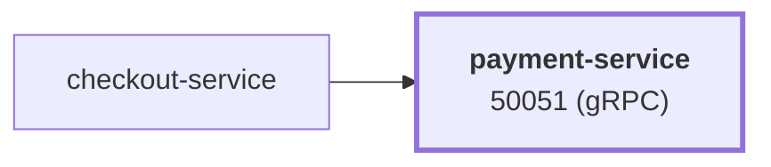

# payment-service

service · platform-demo

A gRPC service that "processes" payments for the platform-demo e-commerce platform. It validates a credit card (number checksum, brand, expiry) and returns a random transaction ID. **No real payment provider is involved and nothing is persisted** — it is a simulation. It is stateless, has no downstream dependencies, and is called only by `checkout-service`.

Runtime<strong>Node 22</strong><small>TypeScript</small>

Listens on<strong>50051</strong><small>gRPC</small>

State<strong>Stateless</strong>

Image<strong>payment-service</strong><small>mladenovskistefan/</small>

## Where it sits

Called by `checkout-service`. It has no downstream dependencies.

## At a glance

| | |
|---|---|
| **Language / runtime** | TypeScript on Node.js 22 (`@grpc/grpc-js`) |
| **Image** | `mladenovskistefan/payment-service` |
| **Protocol / port** | gRPC (HTTP/2, plaintext) on `50051` |
| **Metrics** | Pushed over OTLP/gRPC to Alloy → Mimir every 15 s (no scrape endpoint). Dashboard names: `rpc_server_duration_seconds_{bucket,count,sum}`, `rpc_server_requests_total`, `rpc_server_active_requests` |
| **Health** | `grpc.health.v1.Health/Check` on `50051` — static `SERVING` |
| **State** | None |
| **Depends on** | Nothing (optional: OTLP collector, Pyroscope) |
| **Called by** | `checkout-service` (`Charge`) |
| **gRPC reflection** | Not enabled — pass `-proto` to `grpcurl` |

## Find it elsewhere

<h4><a href="https://argocd.platform-demo.click/applications/argocd/dev-payment-service">Argo CD</a></h4>
Sync and health of <code>dev-payment-service</code>.

<h4><a href="https://github.com/platform-boutique/app-payment-service">Repository</a></h4>
Source, pull requests and releases of <code>app-payment-service</code>.

!!! info "Part of the platform-demo platform"
    Cross-cutting facts (service wiring, observability contract, Kubernetes translation, CI/CD) are in the
    [master reference](https://github.com/platform-boutique/platform-demo-docs). This site only describes payment-service.
